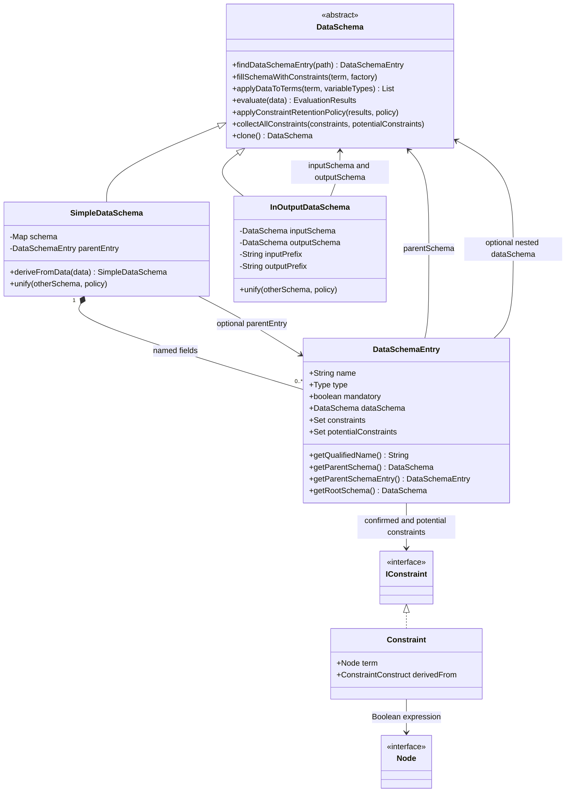
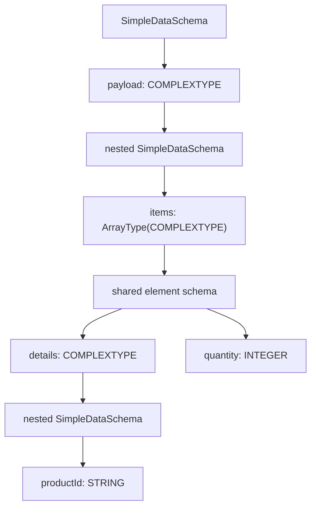
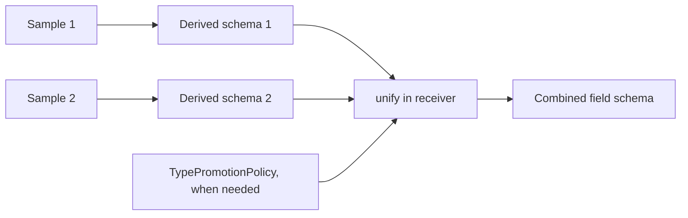
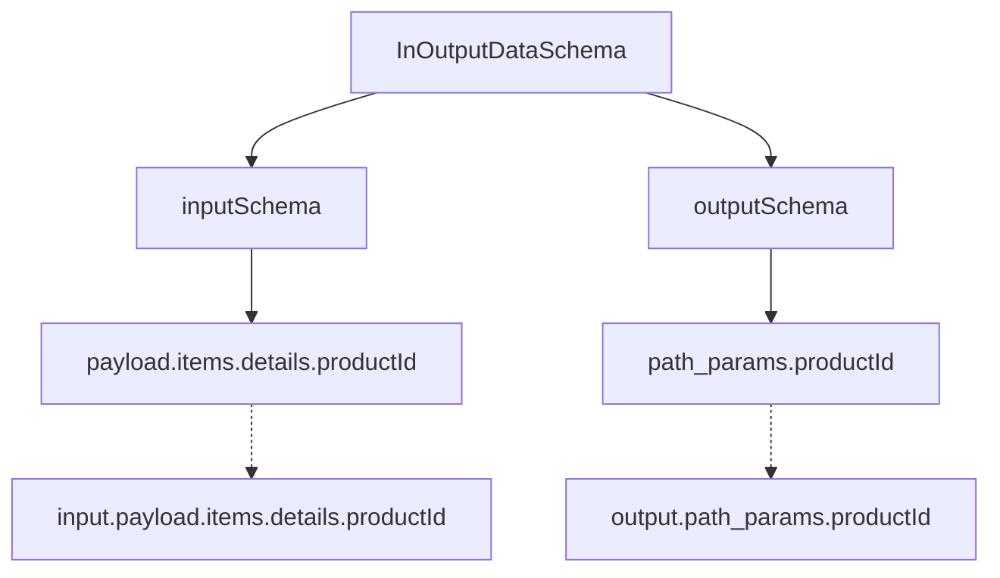
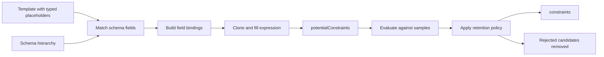
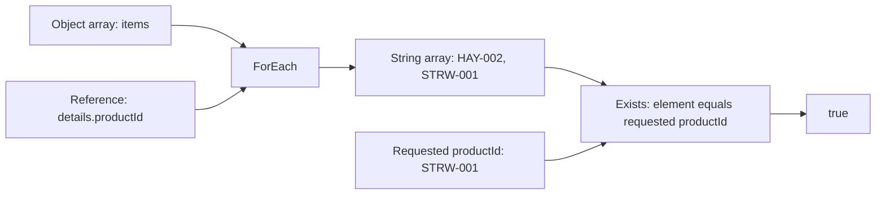
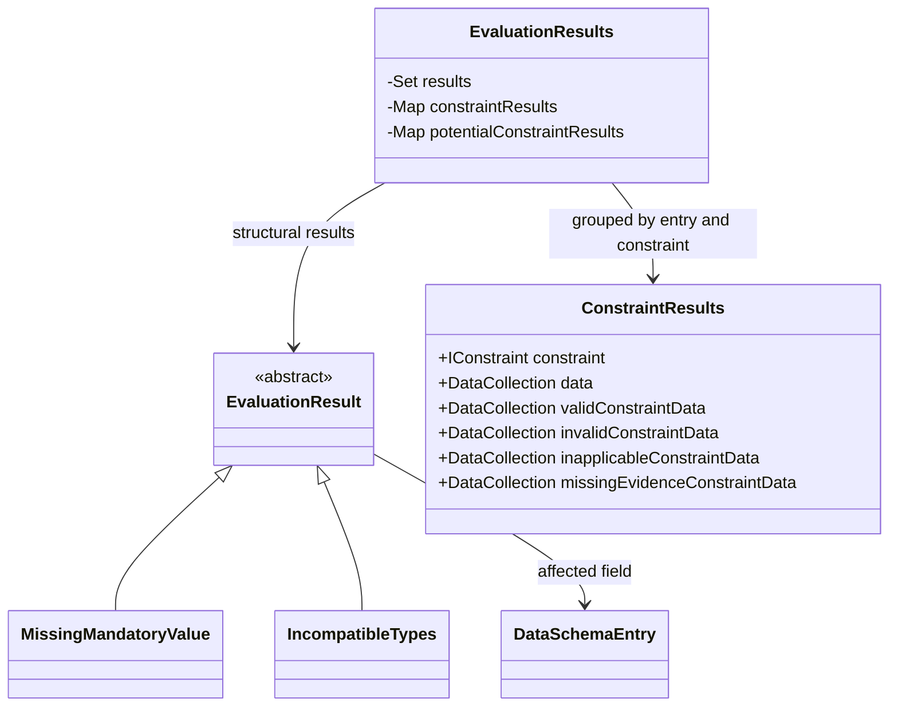

# Data schemas

The classes in `at.sfischer.constraints.data` describe the structure of observed
data and constraints relating its fields. A schema contains field definitions and
constraint expressions. Payload values live in separate data objects and collections.

This document describes the current Java implementation. For graph ownership,
sample pairing, and finalization, see [Graph data model](graph-model.md).

## Main classes



| Class | Responsibility |
| --- | --- |
| [`DataSchema`](../src/main/java/at/sfischer/constraints/data/DataSchema.java) | Shared field binding, constraint generation, evaluation support, and retention |
| [`SimpleDataSchema`](../src/main/java/at/sfischer/constraints/data/SimpleDataSchema.java) | A map of named fields, including nested object and array fields |
| [`InOutputDataSchema`](../src/main/java/at/sfischer/constraints/data/InOutputDataSchema.java) | Two schemas with separate namespaces, usually input and output |
| [`DataSchemaEntry`](../src/main/java/at/sfischer/constraints/data/DataSchemaEntry.java) | One field's type, presence requirement, hierarchy, and attached constraints |
| [`DataObject`](../src/main/java/at/sfischer/constraints/data/DataObject.java) | Actual named payload values |
| [`DataValue`](../src/main/java/at/sfischer/constraints/data/DataValue.java) | A payload value together with its `Type` |
| `SimpleDataCollection` | Ordered `DataObject` samples |
| `InOutputDataCollection` | Ordered pairs of input/output `DataObject` samples |

The generic parameter of `DataSchemaEntry<T>` describes its schema type. It is not
the Java type of the field's payload; that information is represented by `type`.

## Fields, nesting, and qualified names

Each entry has the following state:

| Member | Meaning |
| --- | --- |
| `name` | Local field name, such as `productId` |
| `type` | Scalar, complex object, or array type |
| `mandatory` | Whether absence of this field produces `MissingMandatoryValue` |
| `dataSchema` | Nested field schema for an object or complex array elements; otherwise usually null |
| `parentSchema` | The schema containing this field |
| `constraints` | Confirmed constraints attached to this field |
| `potentialConstraints` | Candidate constraints awaiting evaluation and retention |

`SimpleDataSchema` stores entries by local name. Methods such as `stringEntry`,
`integerEntry`, `objectEntry`, and `objectArrayEntry` create entries using
`computeIfAbsent`: asking for an existing name returns the existing entry rather
than changing its type or mandatory flag.

An object field has `COMPLEXTYPE` and a nested `SimpleDataSchema`. An object-array
field has `ArrayType(COMPLEXTYPE)` and one nested schema describing the element
fields. It does not create a schema entry per array index.

For example, this payload:

```json
{
  "payload": {
    "items": [
      {"details": {"productId": "HAY-002"}, "quantity": 1},
      {"details": {"productId": "STRW-001"}, "quantity": 2}
    ]
  }
}
```

has this schema hierarchy:



The full field name is `payload.items.details.productId`. Neither an array index
nor `[]` appears in a qualified schema name.

`getQualifiedName()` walks the parent-entry chain. `findDataSchemaEntry(path)` walks
the nested schemas using a dot-separated path. These operations identify schema
fields; they do not select a particular array element from a payload.

### Manual construction

```java
SimpleDataSchema schema = new SimpleDataSchema();
DataSchemaEntry<SimpleDataSchema> payload = schema.objectEntry("payload", true);
DataSchemaEntry<SimpleDataSchema> items = payload.dataSchema.objectArrayEntry("items", true);
DataSchemaEntry<SimpleDataSchema> details = items.dataSchema.objectEntry("details", true);
DataSchemaEntry<SimpleDataSchema> productId = details.dataSchema.stringEntry("productId", true);
items.dataSchema.integerEntry("quantity", true);

DataSchemaEntry<SimpleDataSchema> found =
        schema.findDataSchemaEntry("payload.items.details.productId");
String qualifiedName = productId.getQualifiedName();
```

`found` is the same entry instance as `productId`.

## Types and compatibility

[`Type`](../src/main/java/at/sfischer/constraints/model/Type.java) provides
`canAssignTo(target)`. Its implementations are
[`TypeEnum`](../src/main/java/at/sfischer/constraints/model/TypeEnum.java) and
[`ArrayType`](../src/main/java/at/sfischer/constraints/model/ArrayType.java).

| Type | Describes |
| --- | --- |
| `INTEGER` | Integer values |
| `NUMBER` | General numeric values |
| `BOOLEAN` | Boolean values |
| `STRING` | String values |
| `COMPLEXTYPE` | A `DataObject` with named fields |
| `ANY` | A wildcard used in expression typing |
| `ArrayType(elementType)` | An array whose elements have the specified type |

Compatibility is directional. `INTEGER` can be assigned to `NUMBER`; `NUMBER`
cannot be assigned to `INTEGER`. Other concrete enum types normally match
themselves. `TypeEnum` treats `ANY` as a wildcard. `ArrayType` separately requires
an array target and recursively checks its element type, so
`ArrayType(INTEGER)` can be assigned to `ArrayType(NUMBER)`.

Nested arrays use nested types, for example `ArrayType(ArrayType(STRING))`.
Arrays whose innermost elements are complex objects also have a nested field schema.

Types are used for field matching, schema reconciliation, and evaluation. They do
not themselves describe business rules such as minimum quantities or valid IDs;
those rules belong in constraints.

## Deriving and combining schemas

`SimpleDataSchema.deriveFromData(data, policy)` derives a schema from a typed
`DataObject`. Present fields start as mandatory. Objects are processed recursively;
for complex arrays, element schemas are combined to describe all observed elements.

Collections derive a schema by deriving individual sample schemas and repeatedly
calling `unify`. An input/output collection derives each side separately, preserving
the pairing of the samples for subsequent evaluation.



`SimpleDataSchema.unify(other, policy)` mutates its receiver:

1. Fields present in both schemas keep a compatible type or select a wider type.
2. If neither type can accept the other, the policy is asked for a replacement type.
   Without a policy, or if the policy returns null, unification throws
   `IllegalStateException`.
3. Nested schemas are unified recursively when the receiver has a nested schema.
4. Fields present in only one operand become optional in the combined schema.

For fields present in both operands, the current implementation does not explicitly
combine their `mandatory` flags. Unification is an in-place operation, rather than
a general immutable or order-independent schema merge.

For example, combining these samples produces `price: NUMBER` and optional
`description` and `stock` fields:

```java
SimpleDataCollection samples = new SimpleDataCollection();
samples.addDataEntry(DataObject.parseData("{price:10,description:'Hay'}"));
samples.addDataEntry(DataObject.parseData("{price:12.5,stock:3}"));

SimpleDataSchema schema = samples.deriveSchema(null);
DataSchemaEntry<SimpleDataSchema> price = schema.findDataSchemaEntry("price");
DataSchemaEntry<SimpleDataSchema> description = schema.findDataSchemaEntry("description");
```

Numeric widening here uses the normal assignment rules; it does not need a policy.
`DefaultTypePromotionPolicy` handles additional scalar combinations, such as a
number and string becoming `STRING`. `DefaultArrayTypePromotionPolicy` additionally
handles an array and a scalar with exactly its element type. Promotion selects a
schema type; it does not convert the stored payload values.

Policy propagation depends on the entry point. `InOutputDataCollection.deriveSchema`
passes its policy into per-sample derivation and unification. In the current
implementation, `SimpleDataCollection.deriveSchema` passes it into cross-sample
unification, while its per-sample derivation uses the no-policy overload. Nested
object derivation also uses that overload. Do not assume a policy is applied to
every nested derivation step.

## Input/output schemas and namespaces

`InOutputDataSchema<SCHEMA extends DataSchema>` contains two schemas of the same
generic schema type. Commonly both are `SimpleDataSchema`, but input/output wrappers
can also be nested.

The default namespaces are `input` and `output`. The constructor connects each side
to a synthetic complex parent entry bearing its prefix. Consequently an entry named
`productId` on the output side has the qualified name `output.productId`.



`InOutputDataCollection.addDataEntry(input, output)` wraps the supplied raw objects
under those prefixes. Its stored row is a pair of wrapper objects. Use
`getInputData(row)` and `getOutputData(row)` to unwrap a stored row, or use
`getInputDataCollection()` and `getOutputDataCollection()` to inspect either side.
Reinserting an already wrapped pair through `addDataEntry` wraps it again.

Custom prefixes are supported by both the schema constructor and the collection's
`addDataEntry` overloads. They must agree when evaluating data.

```java
SimpleDataSchema request = new SimpleDataSchema();
request.stringEntry("cartId", true);
SimpleDataSchema response = new SimpleDataSchema();
response.integerEntry("itemCount", true);
InOutputDataSchema<SimpleDataSchema> schema =
        new InOutputDataSchema<>(request, response);

DataSchemaEntry<SimpleDataSchema> count = schema.findDataSchemaEntry("output.itemCount");
```

The two sides are general namespaces for paired observations. During data-flow
inference, the temporary schema's input may hold an earlier call's **response** and
its output may hold a later call's **request**. The schema names do not determine
the original transport direction.

## Generating candidate constraints

[`Constraint`](../src/main/java/at/sfischer/constraints/Constraint.java) wraps a
Boolean expression (`Node`) and optional provenance (`derivedFrom`). The expression
can use comparisons, logical operators, array operations, and field references.

`fillSchemaWithConstraints(template, factory)` generates candidate constraints:

1. Infer the expected types of the template's placeholder variables.
2. Find compatible schema fields, including fields in nested schemas.
3. Generate combinations assigning fields to placeholders.
4. Clone the template and substitute field expressions for those placeholders.
5. Ask the `ConstraintFactory` to create constraints and attach them to an entry's
   `potentialConstraints` set.

For a simple schema, combinations bind distinct fields to placeholders, and the
constraint is attached to a participating field with the smallest nesting depth.
For an input/output schema, the implementation combines non-overlapping partial
placeholder assignments from both sides, requiring both sides to contribute. It
attaches candidates to a participating field on the output side, preferring the
smallest nesting depth there. Attachment is a storage choice; a constraint can
reference fields elsewhere in the hierarchy.

[`DataReference`](../src/main/java/at/sfischer/constraints/model/DataReference.java)
is the normal field expression. It extends `Variable`, captures the entry's
qualified name, and retains the entry reference. Candidate generation does not
establish that the relationship is true: evaluation and retention are separate steps.



An overload accepting `replacementTerms` also generates templates by substituting
compatible expression terms for placeholders, with fresh variable names to avoid
collisions. This expands the candidate expressions; it is distinct from projecting
a field out of an object array.

## Fields inside complex arrays

A field such as `input.payload.items.details.productId` describes a string field
inside each item. A membership template needs an **array of strings**, rather than
a scalar reference expanded separately for every item.

The shared binding logic in `DataSchema` handles this using projection:

1. `matchesArrayField` checks whether the placeholder expects an array whose element
   type accepts the field's type, and whether the field has an enclosing array.
2. `fieldReference` finds the nearest enclosing array entry.
3. It removes that array's complete qualified-name prefix to obtain an element-relative
   path, such as `details.productId`.
4. It creates a typed `Reference(ARRAY_ELEMENT, relativePath, field.type)`.
5. It wraps the array reference and element operation in `ForEach`.

Conceptually, a field binding becomes:

```text
ForEach(
    DataReference(input.payload.items),
    Reference(ARRAY_ELEMENT, "details.productId", STRING)
)
```

This operation evaluates to `ArrayType(STRING)`. The explicit return type on
`Reference` allows `ForEach` to retain the projected element type through cloning
and substitution.



The schema binder changes the value supplied to the template's array placeholder.
It does not need to inspect or replace the surrounding `Exists`, `ForAll`, or other
operator. For example:

```text
Template:
    Exists(a, StringEquals(ARRAY_ELEMENT, b))

Bound expression:
    Exists(
        ForEach(DataReference(input.payload.items),
                Reference(ARRAY_ELEMENT, "details.productId", STRING)),
        StringEquals(ARRAY_ELEMENT, DataReference(output.path_params.productId))
    )
```

The projection's `ARRAY_ELEMENT` denotes an object item; the outer `Exists` uses
its own element binding for each projected string. These bindings remain separate.

For `[HAY-002, STRW-001]`, membership succeeds for either product and fails for an
absent ID. A `ForAll` template instead requires every projected value to match.
On a typed empty projected array, `Exists` is false and `ForAll` is true. An
`ArrayEquals` template can use the same projection without a quantifier.

Nested object paths inside an element are supported by the relative path. This
does not imply automatic flattening of arbitrarily nested arrays: the binding uses
the nearest enclosing array, and `Reference` traverses object fields.

There is also an older scalar-from-array candidate path in `findMatchingEntries`:
when a scalar placeholder matches an array's element type, it can generate a
`ForAll` wrapper, guarded by a recursion count. That path has universal semantics;
it is separate from supplying an array-valued projection to an explicit membership
template.

### Schema filling versus applyDataToTerms

These are different APIs, despite both using the schema hierarchy:

| API | Binding path | Result |
| --- | --- | --- |
| `fillSchemaWithConstraints` | Field matching, combinations, `fieldReference`, and `ForEach` projection | Candidate `IConstraint` objects stored on schema entries |
| `applyDataToTerms` | `findAssignableFields` with variable and array dereference providers | A returned list of filled expression nodes |

`arrayDereferenceProvider` belongs to the latter path. Changing it does not change
how `fillSchemaWithConstraints` binds fields. For paired schemas,
`applyDataToTerms` binds placeholders through the input and output schemas in
sequence; neither method accepts payload samples as its primary binding input.

## Evaluation and retention

`schema.evaluate(data)` collects confirmed and potential constraints and returns
[`EvaluationResults`](../src/main/java/at/sfischer/constraints/data/EvaluationResults.java).
It does not automatically promote candidates to confirmed constraints.

Evaluation has two distinct kinds of results:

| Result | Meaning |
| --- | --- |
| `MissingMandatoryValue` | A required field was absent |
| `IncompatibleTypes` | A value's type could not be assigned to the schema field type |
| Confirmed constraint results | Outcomes for constraints already in `constraints` |
| Potential constraint results | Outcomes for candidates in `potentialConstraints` |

Structural checks walk the known fields, nested objects, and direct complex array
elements. Extra payload fields are not rejected. Nested array derivation and
structural validation use different code paths; support for representing nested
array types is not a guarantee that every nested shape is validated recursively.

Each [`ConstraintResults`](../src/main/java/at/sfischer/constraints/ConstraintResults.java)
contains the original data and collections of valid, invalid, inapplicable, and
missing-evidence samples. A missing/unresolved expression is not the same as a
Boolean false result. Evaluation can also produce several value combinations for
array-related field paths; a counterexample makes that sample invalid. Explicit
array operators are therefore important when expressing membership.



`applyConstraintRetentionPolicy(results, policy)` removes each evaluated candidate
from `potentialConstraints` and adds accepted candidates to `constraints`.
`NoViolationsPolicy` accepts candidates with no recorded counterexamples; it does
not itself require a minimum number of successful applications. Other policies can
require additional evidence, and a `ConstraintConstruct` can supply its own policy.

Collection helpers can gather constraints recursively, filter by provenance, or
select specific constraints. The existing `clearConstrains()` method clears both
sets throughout the hierarchy; the spelling here matches the implemented API.

### End-to-end membership example

```java
InOutputDataCollection samples = new InOutputDataCollection();
DataObject cart = DataObject.parseData(
        "{items:[{details:{productId:'HAY-002'}},{details:{productId:'STRW-001'}}]}"
);
samples.addDataEntry(cart, DataObject.parseData("{path_params:{productId:'HAY-002'}}"));
samples.addDataEntry(cart, DataObject.parseData("{path_params:{productId:'STRW-001'}}"));

InOutputDataSchema<SimpleDataSchema> schema = samples.deriveSchema(null);
Node membership = new Exists(
        new Variable("a"),
        new StringEquals(new Variable(ArrayOperation.ELEMENT_NAME), new Variable("b"))
);
schema.fillSchemaWithConstraints(membership, term -> Set.of(new Constraint(term)));

EvaluationResults<DataSchema, Pair<DataObject, DataObject>> results = schema.evaluate(samples);
schema.applyConstraintRetentionPolicy(results, new NoViolationsPolicy());
```

The generated projection for `items.details.productId` lets the same candidate
membership constraint succeed for both requests. Add an absent product ID as a
third sample and that candidate gets a counterexample, so `NoViolationsPolicy`
rejects it.

The Java snippets use classes from `at.sfischer.constraints`,
`at.sfischer.constraints.data`, `at.sfischer.constraints.model`, the array/string
operator packages, `at.sfischer.constraints.miner`, `org.javatuples.Pair`, and
`java.util.Set`.

## Mutability, copies, and current boundaries

Schemas are mutable shared model objects. Field `type` is public and mutable, and
constraint sets can be edited directly. Graph finalization does not freeze them.
After graph data-flows have been inferred, treat their schemas as read-only to
preserve the field references described in [Graph data model](graph-model.md).

`SimpleDataSchema.clone()` copies the entry hierarchy and each entry's constraint
sets. The contained constraints and expression objects are still shared; cloning
does not rebind their `DataReference` objects to cloned entries.
`InOutputDataSchema.clone()` clones both sides using the default-prefix constructor,
so custom prefixes are not preserved by that implementation.

Constructing a wrapper changes its child schemas' parent links. Unification can
also reuse nested schemas from another operand. Do not treat wrapping, unifying,
or cloning as a guarantee of complete object isolation. `DataReference` captures
its qualified name when constructed, so creating references after assembling the
schema hierarchy avoids stale names caused by later reparenting.

Schemas contain no dedicated nullable type. The current `DataObject.parseData`
implementation omits JSON null properties and empty JSON arrays; it cannot infer
an element type from an empty array. Typed arrays inserted through `putValue` can
retain their array type when empty, but cannot provide unobserved element fields.

An empty `SimpleDataCollection.deriveSchema` returns null. Empty paired collection
derivation has no initialized side schemas and is not an empty-schema factory.
Create empty schemas explicitly when needed; graph finalization handles edges
without observations separately.

Schema `toString()` methods are debugging representations. Graph JSON export
serializes schema entries, nested references, types, and constraints as part of a
graph snapshot; there is no standalone schema JSON importer in this model.

## Related regression tests

- [SimpleDataSchemaTest](../src/test/java/at/sfischer/constraints/data/SimpleDataSchemaTest.java): scalar, object, and complex-array derivation and evaluation.
- [DataSchemaTest](../src/test/java/at/sfischer/constraints/data/DataSchemaTest.java): field lookup, template filling, replacement terms, and evaluation.
- [InOutputDataSchemaTest](../src/test/java/at/sfischer/constraints/data/InOutputDataSchemaTest.java): relationships across paired schemas.
- [SchemaArrayFieldBindingTest](../src/test/java/at/sfischer/constraints/data/SchemaArrayFieldBindingTest.java): multiple products, nested object paths, unchanged template semantics, projection types, and typed empty arrays.
- [InOutputDataSchemaArrayMembershipTest](../src/test/java/at/sfischer/constraints/data/InOutputDataSchemaArrayMembershipTest.java): membership on either side, absent products, and numeric and Boolean fields.
