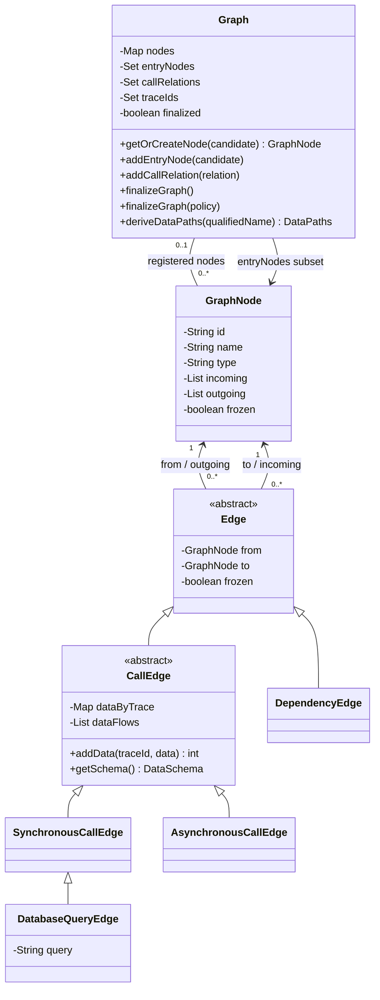
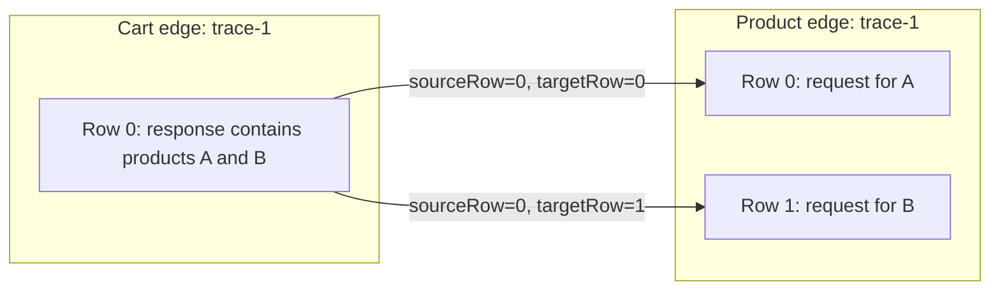
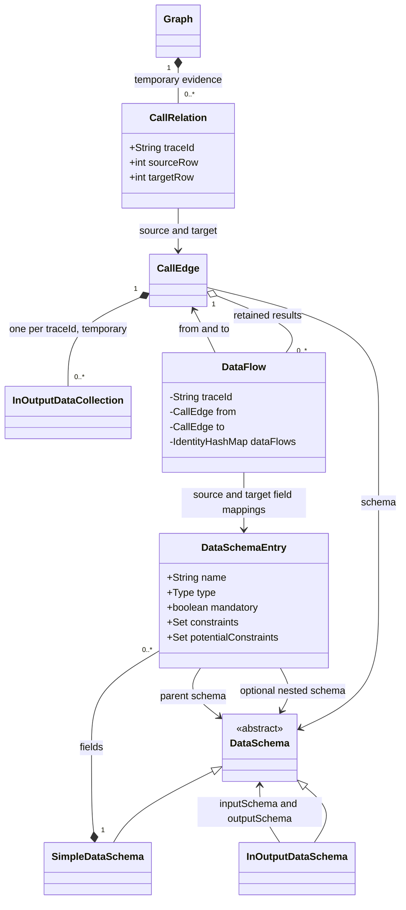
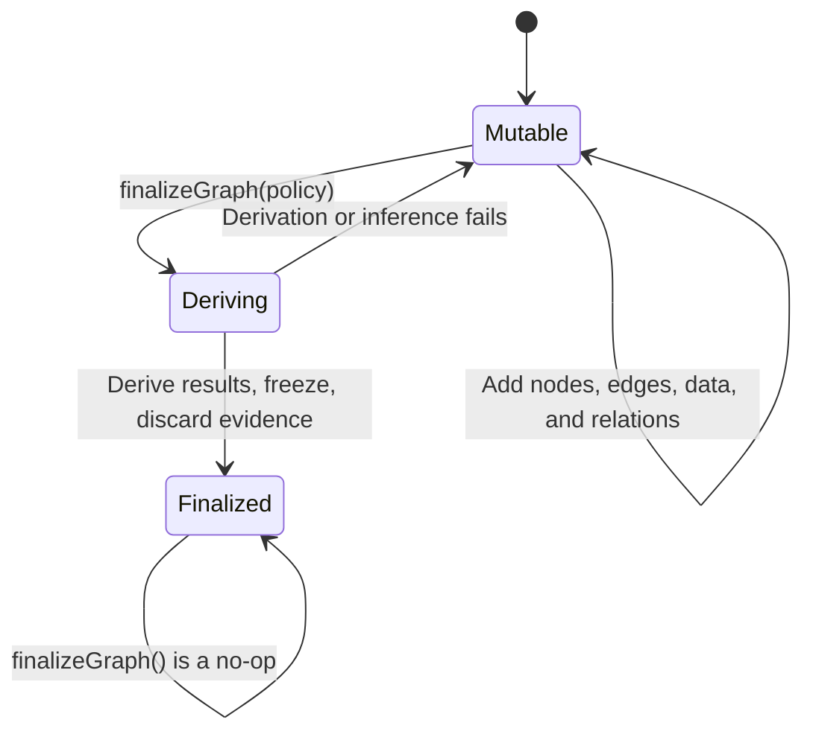

# Graph data model

The classes in `at.sfischer.constraints.data.model` represent a directed call graph,
the data observed on its edges, and inferred relationships between fields on
different edges. The graph is built while mutable and then finalized for inspection
and export.

For field structure, type rules, and constraint inference, see
[Data schemas](data-schemas.md).

There are three parts to the model:

| Part | Main classes | Lifetime |
| --- | --- | --- |
| Topology | `Graph`, `GraphNode`, `Edge` and its subclasses | Retained after finalization |
| Observations | Edge data collections and `CallRelation` | Discarded after successful finalization |
| Derived results | Schemas, `DataFlow`, and derived `DataPaths` | Available for inspection after finalization |

## Topology



### Graph and node identity

[`Graph`](../src/main/java/at/sfischer/constraints/data/model/Graph.java) stores
nodes in a map keyed by their string IDs. `getOrCreateNode(candidate)` returns the
registered instance for that ID, or registers the candidate. A conflicting node
type for an existing ID is rejected. Callers should use the returned instance when
constructing edges.

Each [`GraphNode`](../src/main/java/at/sfischer/constraints/data/model/GraphNode.java)
has an immutable `id`, display `name`, and string `type`. Types can describe roles
such as `service`, `endpoint`, `database`, or `kafka-topic`; the core model does not
restrict them to an enum. The two-argument constructor uses `"unknown"`.

A registered node belongs to one graph. Entry nodes are explicitly marked using
`addEntryNode`; they are a subset of the registered nodes, rather than automatically
being all nodes without incoming edges. Multiple entry nodes are supported.

### Edges and adjacency

An [`Edge`](../src/main/java/at/sfischer/constraints/data/model/Edge.java) has fixed
`from` and `to` node references. Its constructor registers it in both
`from.outgoing` and `to.incoming`. The graph discovers edges through these adjacency
lists; it has no separate edge registry or in-memory edge ID.

Edge endpoints must be the actual node instances registered in the graph. This is
validated when adding call relationships and when finalizing or exporting.

The model permits parallel edges and cycles. Creating another edge between the same
nodes creates another edge instance. Reusing an edge for repeated calls is the
builder's responsibility, rather than an automatic behavior of `Graph`.

| Edge class | Meaning | Schema |
| --- | --- | --- |
| `SynchronousCallEdge` | A request and its response | `InOutputDataSchema<SimpleDataSchema>` |
| `AsynchronousCallEdge` | Data sent without a synchronous response | `SimpleDataSchema`, derived from input only |
| `DatabaseQueryEdge` | A synchronous call with an additional `query` string | Same as `SynchronousCallEdge` |
| `DependencyEdge` | A topology relationship without call data or inferred flows | None |

For an edge from caller to receiver, **input** means data sent to the receiver and
**output** means the receiver's response. A synchronous response is stored on the
same edge; it does not require a separate reverse topology edge.

## Observed data and sample pairing

Each [`CallEdge`](../src/main/java/at/sfischer/constraints/data/model/CallEdge.java)
holds `Map<String, InOutputDataCollection> dataByTrace` while mutable. Each trace
group contains an ordered collection of paired input/output rows. A repeated call
appends another row to the existing edge.

`addData(traceId, collection)` returns the starting row index of the appended batch.
The overload taking individual `DataObject` input and output appends one row; null
input or output becomes an empty object. Equal payloads remain separate rows.
Data is copied on insertion. `getDataByTrace()` returns an unmodifiable map of
defensive collection copies, so inspecting or modifying those copies cannot reorder
the stored rows.

[`CallRelation`](../src/main/java/at/sfischer/constraints/data/model/CallRelation.java)
records which observations should be compared during inference:

```java
CallRelation(String traceId, CallEdge source, int sourceRow,
             CallEdge target, int targetRow)
```

The row indexes are zero-based and local to an edge and trace group. Both rows must
exist under the same `traceId`. Identical relations are deduplicated by the graph's
set. A relation is temporary inference evidence, not an inferred field mapping.

For example, one cart response can supply two product requests:



These links preserve one-to-many pairing. Simply zipping the collections would
miss the second request; comparing every possible row combination could mix
unrelated observations.

## Schemas and inferred data-flows



### Schema structure

`SimpleDataSchema` describes named fields. A `DataSchemaEntry` contains the field's
name, type, mandatory flag, confirmed constraints, and potential constraints. Object
fields and arrays of complex elements reference a nested schema. Parent references
allow a field to provide its full qualified name, such as
`output.payload.items.productId`.

`InOutputDataSchema` wraps separate input and output schemas. Its default prefixes
are `input` and `output`. A synchronous edge uses both schemas; an asynchronous edge
uses a simple schema for its input data.

Schemas derived during finalization combine all rows from all trace groups on an
edge. A supplied `TypePromotionPolicy` controls type reconciliation when needed.
This shared schema describes the observed data shapes; flow inference still keeps
the trace groups separate.

### DataFlow structure and inference

[`DataFlow`](../src/main/java/at/sfischer/constraints/data/model/DataFlow.java)
connects **two call edges**, rather than two graph nodes. It contains a `traceId`,
explicit `from` and `to` edges, and mappings between their schema entries.

The mapping uses an `IdentityHashMap`: fields refer to the exact entry instances in
the edges' schemas. Qualified names alone are insufficient because different edges
can contain equally named fields. Within one `DataFlow`, each source entry has at
most one target entry. The stored result does not retain the matching expression
or individual row indexes.

Inference tests equality and array membership constraints against the related
observations, retaining constraints without violations. Array projections allow
fields inside complex array elements to participate, for example a cart's
`items.productId` field matching a product request's `productId`.

Call edge subclasses select which data sides to compare:

| Relationship passed to inference | Compared data |
| --- | --- |
| Synchronous source; target has the same caller node | Earlier call's output to later call's input |
| Synchronous source and synchronous target with different caller nodes | Source input to target input, plus target output to source output |
| Synchronous source to asynchronous target without the same caller node | Source input to target input |
| Asynchronous source | Source input to target input |

Thus one `CallRelation` group can produce both a forward request flow and a reverse
response flow. Read `DataFlow.getFrom()` and `getTo()` for the actual flow direction.
The source edge type and the supplied relationships determine the comparison; the
model does not discover execution ordering from payload values.

`traceId` is the grouping label used for inference. Different labels preserve
different flow sets even when topology and schemas are shared. It need not be an
original OpenTelemetry trace ID: the trace builder generates labels unless callers
provide them. Supplying the same label for several executions deliberately combines
their related observations into one inference group.

## Construction and finalization



Successful `Graph.finalizeGraph(policy)` performs these steps:

1. Validates that every edge endpoint is registered in the graph.
2. Clears existing flow results when there is collected call data, then derives
   each call edge's schema from all its data.
3. Groups relations by `(traceId, source edge, target edge)`, builds aligned
   collections from those row pairs, and asks the source edge to infer flows.
4. Freezes edges, their flow mappings, and graph nodes.
5. Discards edge data and call relations, retains the graph's trace IDs, and marks
   the graph finalized.

After success, adding topology, observations, relations, or flows is rejected.
Graph/node collections, edge flow lists, and flow maps are exposed read-only.
`getDataByTrace()` and `getCallRelations()` are empty; `Graph.getTraceIds()` retains
the labels, whereas `CallEdge.getTraceIds()` describes only its pending data.

Finalization does **not** freeze shared schema classes or constraint expressions.
Their existing mutable APIs remain available. Treat finalized schemas as read-only
to avoid invalidating field mappings. Derived `DataPaths` are separate traversal
results, not frozen graph state.

Repeated finalization is a no-op. If schema derivation or inference fails, the graph
remains mutable and retains its evidence for correction and retry. This is not a
transactional rollback: schemas or intermediate flow results may already have been
updated before the failure.

Call edge constructors accepting precomputed schemas remain supported. Without
collected data, finalization retains those schemas; an edge without a supplied
schema or data receives an empty schema. Calling `getSchema()` before a schema has
been supplied or derived throws `IllegalStateException`.

### Example

This builds two logical call edges, records two product requests, and links both
requests to the same cart response:

```java
Graph graph = new Graph();
GraphNode checkout = graph.getOrCreateNode(new GraphNode("checkout", "checkout-service", "service"));
GraphNode carts = graph.getOrCreateNode(new GraphNode("carts", "GET /carts/{cartId}", "endpoint"));
GraphNode products = graph.getOrCreateNode(new GraphNode("products", "GET /products/{productId}", "endpoint"));
graph.addEntryNode(checkout);

SynchronousCallEdge cartCall = new SynchronousCallEdge(checkout, carts);
SynchronousCallEdge productCall = new SynchronousCallEdge(checkout, products);
String traceId = "trace-1";

int cartRow = cartCall.addData(traceId, new DataObject(),
        DataObject.parseData("{items:[{productId:'A'},{productId:'B'}]}"));
int firstProductRow = productCall.addData(traceId,
        DataObject.parseData("{productId:'A'}"), new DataObject());
int secondProductRow = productCall.addData(traceId,
        DataObject.parseData("{productId:'B'}"), new DataObject());

graph.addCallRelation(new CallRelation(traceId, cartCall, cartRow, productCall, firstProductRow));
graph.addCallRelation(new CallRelation(traceId, cartCall, cartRow, productCall, secondProductRow));
graph.finalizeGraph();

List<DataFlow> flows = cartCall.getDataFlowsTo(productCall);
String json = GraphJsonExporter.export(graph);
```

The example uses classes from `at.sfischer.constraints.data`,
`at.sfischer.constraints.data.model`, `at.sfischer.constraints.data.model.utils`,
and `java.util.List`.

## Following fields across edges

[`DataPaths`](../src/main/java/at/sfischer/constraints/data/model/DataPaths.java)
contains root `DataPathNode` objects. Each node references a call edge, one schema
entry on that edge, and a list of next path nodes.

`Graph.deriveDataPaths(qualifiedName)` starts at the graph's entry nodes and searches
their outgoing call schemas for the field. `GraphNode.deriveDataPaths(entry)` can
start from a specific entry instance. Traversal follows directed field mappings
within the same trace label and stops revisiting an edge/field pair to handle cycles.
`DataPathNode` itself stores no trace ID; the trace is used during traversal.

## Export

[`GraphJsonExporter`](../src/main/java/at/sfischer/constraints/data/model/utils/GraphJsonExporter.java)
provides `export(graph)` and `write(graph, path)`. It produces a versioned JSON
snapshot with separate tables for nodes, edges, schemas, schema entries, data-flows,
and constraint/expression objects. References preserve shared object identities.
Generated edge, schema, and field IDs are local to the snapshot.

The snapshot includes `finalized` and `traceIds`. Pending call data prevents export;
raw observations and `CallRelation` records are not serialized. Schema-only graphs
can also be exported without finalization. There is no corresponding graph importer.

`GraphVizExporter.export(graph)` produces DOT containing topology only; it omits
schemas and data-flows.
