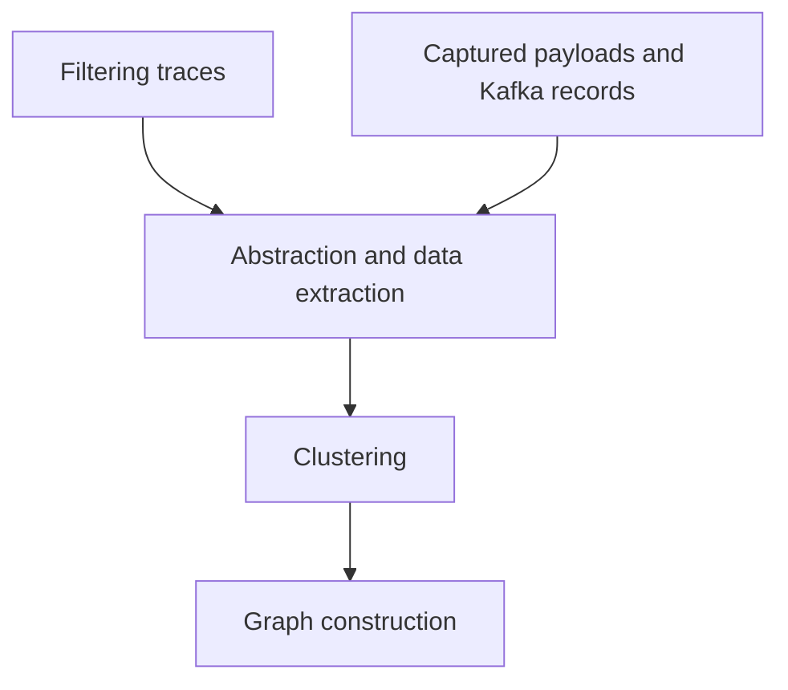

# Trace analysis and SDG generation

[`Main.java`](src/main/java/at/scch/traceon/Main.java) runs an offline pipeline that transforms recorded OpenTelemetry traces into service dependency graphs (SDGs). Captured request, response, and message payloads enrich these graphs with data schemas and inferred data flows.

## 1. Filtering traces

The pipeline reads recorded spans from `spans.jsonl` and reconstructs their parent/child relationships into trace trees. It keeps trees containing at least two spans for further processing.

Additional exclusions are applied during abstraction and before clustering: HTTP spans from the simulation and administration backends are skipped, and roots representing `POST /admin/products/reset` are excluded from clustering.

## 2. Abstraction and data extraction

This stage combines two tasks: simplifying the trace structure and extracting the data exchanged by each interaction.

**Trace abstraction** retains HTTP calls, MongoDB and Redis operations, and Kafka messaging. Unsupported spans are bypassed while their relevant descendants remain connected to the nearest retained ancestor. Retained spans receive normalized operation names and selected service/protocol attributes; HTTP operations use their method and inferred route.

**Data extraction** enriches each retained span with observed input and output data:

- **HTTP:** Match request and response captures from `captures.jsonl`, decode their payloads, and add URL parameters to the input data.
- **MongoDB and Redis:** Match captures from `captures.jsonl` and decode database requests/commands and their responses into input/output objects.
- **Kafka:** Match message records from `records.jsonl` and extract their payloads as input data. Kafka spans have no output data in this pipeline.

When multiple payloads match, they are collected in a `results` array; missing payloads leave the corresponding data absent. The resulting abstract tree therefore describes both **which interactions occurred** and **what data they exchanged**. Clustering accumulates these samples across executions so graph finalization can derive schemas and infer data flows.

## 3. Clustering

Abstract traces are grouped when their tree structure, span names, kinds, and retained attributes match. Payload values are not part of this comparison, allowing repeated executions with different data to belong to the same cluster.

Each cluster accumulates input/output samples at corresponding positions in the trace tree. It therefore represents an observed interaction pattern together with the data collected across its executions. Different structures or retained attributes produce separate clusters.

## 4. Graph construction

Each cluster becomes a separate SDG. Abstract interactions are translated into graph fragments containing services, HTTP endpoints, databases, or Kafka topics. These fragments are connected through synchronous calls, database queries, and asynchronous messaging calls, reusing matching nodes within the graph.

The accumulated payload samples are associated with call edges. During graph finalization, the pipeline derives call schemas and infers data flows in three steps:

1. **Select related calls:** Use the trace structure to identify parent/child calls, sibling calls, and connections within graph fragments. Samples are paired within the same execution, then evaluated together across the cluster.
2. **Compare exchanged data:** For nested synchronous calls, compare the incoming request with the downstream request, and the downstream response with the enclosing response. Between sibling calls made by the same node, compare the earlier response with the later request. Asynchronous calls use their message/input payloads.
3. **Retain consistent field relationships:** Test candidate relationships such as equal string, numeric, boolean, or array values, and whether a value occurs in an array. Keep relationships with no observed violations and record mappings between the corresponding fields in the call schemas. Field names do not have to match.

For example, if a product ID returned by one call consistently appears in a later call's request, the pipeline can link those fields as a data flow. These mappings describe relationships supported by the observed samples; they do not prove that one call caused the value in another.

The finalized graph retains the schemas and inferred field mappings and releases the raw samples used to compute them.

## Output

The pipeline writes one graph JSON file per cluster beside the input trace file, using unique filenames to avoid overwriting earlier exports. It also prints a Graphviz DOT representation for visualization. The result is a set of SDGs describing the interaction patterns observed in the traces, enriched with schema and data-flow information.
